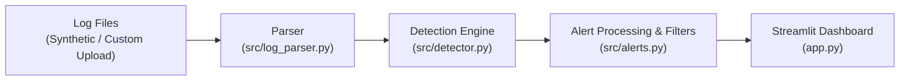

# Mini-SOC — SSH Security Monitoring

An educational Mini-SOC (Security Operations Center) platform for passive analysis, threat detection, and incident triage of Linux SSH authentication logs using synthetic data.

[](https://www.python.org/)
[](https://streamlit.io/)
[](https://pandas.pydata.org/)
[](https://plotly.com/)
[](https://attack.mitre.org/techniques/T1110/)

---

## 1. Project Title
**Mini-SOC — SSH Security Monitoring**

---

## 2. Project Description
**Mini-SOC — SSH Security Monitoring** is a lightweight, educational SIEM/SOC analytics workbench built to demonstrate modern defensive security workflows. The application parses raw Linux `auth.log` telemetry, extracts structured security events, runs an in-memory correlation engine to identify malicious authentication patterns (SSH brute force, password spraying, and compromised account takeovers), maps incidents directly to the **MITRE ATT&CK®** framework, and surfaces high-priority findings in an interactive **Streamlit** dashboard with dedicated triage guidance.

> **Note:** This project is an educational, self-contained log analysis platform and correlation engine. It is **not** a live Wazuh cluster deployment; rather, it emulates the log ingestion, correlation, and rule-based alerting logic typical of a Tier 1/2 SOC environment.

---

## 3. Objectives
The project demonstrates practical, hands-on skills in cybersecurity engineering, defensive monitoring, and SOC operations:
* **Log Parsing & Normalization:** Transforming unstructured, heterogeneous Linux Syslog lines into structured, schema-compliant security events.
* **Threat Detection Engineering:** Developing correlation rules with configurable sliding time windows and dynamic thresholds to detect adversarial authentication behaviors.
* **Threat Taxonomy Alignment:** Mapping detections to standardized MITRE ATT&CK techniques (`T1110.001`, `T1110.003`, `T1110`).
* **SOC Analyst Experience:** Designing a unified triage interface featuring key operational metrics (KPIs), temporal activity histograms, attacker IP rankings, and targeted account breakdowns.
* **Defensive Incident Triage:** Providing contextual incident recommendations and action checklists for investigating potential compromises.
* **Defensive Engineering Rigor:** Ensuring resilient, fault-tolerant software design with zero external network dependencies and RFC 5737 compliant synthetic data.

---

## 4. Key Features
Every feature listed below is fully implemented and operational within the codebase:

* **SSH Log Parsing:** Ingests Linux authentication logs (`auth.log`), supporting both standard BSD Syslog (RFC 3164) and ISO 8601 (RFC 5424) timestamp formats. Extracts timestamps, hostnames, daemon processes, PIDs, authentication statuses (`failed_password`, `accepted_password`, `accepted_publickey`, `invalid_user`, `session_opened`, `session_closed`), usernames, source IPs, and ports.
* **Brute-Force Detection:** Detects high-frequency authentication failures targeting single or multiple accounts from the same source IP within a sliding time window.
* **Password Spraying Detection:** Detects horizontal authentication attacks where a single source IP attempts logins across multiple distinct usernames over an extended window.
* **Successful Login After Multiple Failures:** Identifies suspicious account compromise scenarios where repeated authentication failures from an IP address are immediately followed by an accepted authentication.
* **Severity Levels:** Categorizes detected incidents into standardized severity tiers (`medium`, `high`, `critical`) based on attack velocity and risk impact.
* **MITRE ATT&CK Mapping:** Labels every generated alert with its corresponding MITRE ATT&CK identifier (`T1110`, `T1110.001`, `T1110.003`).
* **Alert Filtering:** Enables multi-criteria filtering across severity tiers, source IP addresses, triggered rule names, and MITRE techniques in real time.
* **CSV/JSON Export:** Exports filtered or full security alerts into structured CSV or formatted JSON files for SIEM ingestion or incident reporting.
* **Interactive Streamlit Dashboard:** Features operational KPI metric cards, temporal activity bar charts, horizontal distribution charts for top attacker IPs and targeted users, a color-coded alert summary table, and an interactive triage inspection panel with response recommendations.
* **Synthetic Log Scenarios:** Ships with ready-to-use synthetic log datasets covering both an evolving multi-stage attack and a normal benign baseline.
* **Passive / Offline Analysis:** Operates entirely locally and defensively; performs zero active network requests, zero port scans, and zero offensive exploits.

---

## 5. Architecture
The platform follows a modular, feed-forward analytical pipeline:



### Architectural Workflow:
1. **Log Ingestion (`data/` or Custom Upload):** The system accepts local log files or custom uploads via Streamlit's file uploader.
2. **Parsing & Structuring (`src/log_parser.py`):**
   * Processes raw log lines using modular regular expressions.
   * Extracts Syslog headers, timestamps (normalizing BSD and ISO formats), hostnames, processes, usernames, IP addresses, ports, and event categories.
   * Gracefully classifies unrecognized or commented lines without interrupting execution.
3. **Threat Detection & Correlation (`src/detector.py`):**
   * Normalizes incoming event streams and deduplicates paired SSH failure logs (e.g., `invalid_user` and `failed_password` for the same attempt).
   * Applies sliding time-window algorithms across grouped source IPs to evaluate threshold violations.
   * Produces structured `Alert` dataclass instances.
4. **Alert Processing & Formatting (`src/alerts.py`):**
   * Normalizes alert dictionaries and validates schemas.
   * Converts alert structures into typed Pandas DataFrames.
   * Applies multi-criteria filters (severity, IP, rule, MITRE technique).
   * Generates sanitized CSV and formatted JSON export payloads.
5. **Presentation & Triage (`app.py`):**
   * Visualizes operational telemetry using Plotly charts and Streamlit KPI metrics.
   * Displays interactive tables with styled severity badges.
   * Renders incident triage cards with analyst guidance and download buttons.

---

## 6. Detection Rules
The correlation engine implements three distinct detection rules grounded in threat actor behavior:

| Rule Name | MITRE ATT&CK | Default Window | Default Threshold | Severity | Description |
| :--- | :--- | :--- | :--- | :--- | :--- |
| **SSH Brute Force** | `T1110.001` (Password Guessing) | 5 minutes *(configurable: 1, 5, 15 min)* | $\ge 5$ failures *(configurable: 2–20)* | **Medium** (5–9 failures)<br>**High** ($\ge 10$ failures) | Detects rapid, repeated authentication failures originating from a single source IP address against one or more accounts. |
| **SSH Password Spraying** | `T1110.003` (Password Spraying) | 15 minutes | $\ge 5$ distinct usernames | **High** | Identifies horizontal credential testing where a single source IP attempts logins across multiple accounts to avoid account lockouts. |
| **Successful Login After Multiple Failures** | `T1110` (Brute Force / Account Takeover) | 15 minutes lookback | $\ge 5$ prior failures | **Critical** | Flags a successful authentication (`accepted_password` or `accepted_publickey`) immediately preceded by repeated failed attempts from the same source IP. Serves as a strong Indicator of Compromise (IoC). |

---

## 7. Project Structure
The repository is structured as follows (excluding virtual environments and runtime caches):

```text
mini-soc-wazuh/
├── data/
│   ├── brute_force_scenario.log   # Multi-stage synthetic attack scenario log
│   ├── README.md                  # Documentation of synthetic datasets and RFC 5737 ranges
│   └── synthetic_auth.log         # Benign baseline operational log
├── src/
│   ├── __init__.py                # Package initialization
│   ├── alerts.py                  # Alert data normalization, filtering, and CSV/JSON export
│   ├── detector.py                # Time-window correlation engine & threat detection rules
│   └── log_parser.py              # Syslog / auth.log regex parser and event normalizer
├── tests/
│   └── __init__.py                # Test package initialization
├── .gitignore                     # Git ignore rules (virtualenv, cache, sensitive files)
├── app.py                         # Streamlit web dashboard and analyst UI
├── README.md                      # Project documentation
└── requirements.txt               # Project dependencies
```

---

## 8. Technologies
The project relies on a minimal, robust Python stack without heavy external runtime dependencies:

* **[Python](https://www.python.org/) (3.10+):** Core language utilizing standard library modules (`re`, `datetime`, `dataclasses`, `pathlib`, `csv`, `json`).
* **[Streamlit](https://streamlit.io/):** Interactive web application framework powering the SOC analyst interface, sidebar controls, KPI cards, and file ingestion.
* **[Pandas](https://pandas.pydata.org/):** Tabular data manipulation, time-series indexing, aggregation, and DataFrame structuring for UI display.
* **[Plotly](https://plotly.com/):** Interactive data visualization library rendering stacked activity timelines and horizontal distribution charts.

---

## 9. Installation
Follow the steps below to set up and run the application on **Windows** using PowerShell or Command Prompt:

### 1. Clone the Repository
```powershell
git clone https://github.com/<your-username>/mini-soc-wazuh.git
cd mini-soc-wazuh
```

### 2. Create a Virtual Environment
```powershell
python -m venv .venv
```

### 3. Activate the Virtual Environment
In **PowerShell**:
```powershell
.venv\Scripts\Activate.ps1
```
*(If script execution is disabled, run `Set-ExecutionPolicy -Scope Process -ExecutionPolicy Bypass` prior to activation)*

Or in **Command Prompt (cmd.exe)**:
```cmd
.venv\Scripts\activate.bat
```

### 4. Install Dependencies
```powershell
pip install -r requirements.txt
```

### 5. Launch the Streamlit Dashboard
```powershell
streamlit run app.py
```
Once launched, the dashboard will open automatically in your browser at `http://localhost:8501`.

---

## 10. Usage

### 1. Data Ingestion
Use the **Source des données** selector in the sidebar:
* **`data/brute_force_scenario.log`:** Loads the simulated multi-stage attack scenario.
* **`data/synthetic_auth.log`:** Loads the benign operational baseline.
* **`Custom Upload`:** Allows uploading any custom Linux `auth.log` or Syslog text file (`.log`, `.txt`).

### 2. Detection Configuration
Tune detection parameters via the sidebar controls:
* **Fenêtre Force Brute (minutes):** Select 1, 5, or 15 minutes for the brute force sliding correlation window.
* **Seuil d'échecs Force Brute:** Adjust the threshold slider (from 2 to 20 failed attempts) to calibrate sensitivity.

### 3. Multi-Criteria Alert Filtering
Filter active alerts using the interactive multiselect controls:
* **Sévérité:** `medium`, `high`, `critical`.
* **Adresses IP source:** Filter by specific attacker or originating IP.
* **Règles déclenchées:** Filter by detection rule name.
* **Techniques MITRE:** Filter by MITRE ATT&CK technique code.

### 4. Operational Monitoring & Visualization
* **Top Metric Cards:** Monitor Total Events, Unique Source IPs, Total Alerts, and Urgent (High/Critical) Alerts.
* **Authentication Activity Over Time:** View an interactive timeline showing the distribution of failed vs. successful authentications.
* **Top Source IPs & Most Targeted Accounts:** Review the top 10 attacker IPs and targeted usernames ranked by failed login volume.

### 5. Incident Triage & Analyst Action
* **Security Alerts Table:** Inspect all detected alerts with severity-based visual highlighting.
* **Incident Details & Triage:** Select any alert from the dropdown to review timestamps, targeted users, and concrete analyst investigation recommendations (correlating system logs, auditing command histories, reviewing authorized SSH keys, and SSH hardening guidelines).

### 6. Exporting Findings
Click **📥 Download CSV** or **📥 Download JSON** at the bottom of the alerts section to generate export files for reporting, documentation, or SIEM integration.

---

## 11. Testing & Validation
The detection engine, parser, and export utilities were tested against real-world test cases:

* **Multi-Stage Attack Scenario (`data/brute_force_scenario.log`):**
  * **Result:** **53 parsed events / 4 security alerts generated**.
  * **Alert Breakdown:**
    1. `High` — **SSH Brute Force** from IP `203.0.113.88` (17 failed attempts in 4 minutes targeting `admin`, `administrator`, `root` — Technique `T1110.001`).
    2. `High` — **SSH Password Spraying** from IP `198.51.100.45` (8 failed attempts across 8 distinct accounts: `backup`, `deploy`, `devops`, `git`, `jenkins`, `oracle`, `postgres`, `service_acc` — Technique `T1110.003`).
    3. `Medium` — **SSH Brute Force** from IP `198.51.100.190` (6 failed attempts in 6 minutes targeting `devops` — Technique `T1110.001`).
    4. `Critical` — **Successful Login After Multiple Failures** from IP `198.51.100.190` (successful authentication on `devops` immediately following 6 failures — Technique `T1110`).
* **Benign Baseline Scenario (`data/synthetic_auth.log`):**
  * **Result:** **42 parsed events / 0 alerts generated**.
  * Confirms that the provided benign baseline scenario produces 0 alerts across routine admin logins, automated cron executions, and occasional typos.
* **Export Verification:**
  * Verified CSV export generates valid RFC 4180 compliant files with delimited `target_users` entries.
  * Verified JSON export outputs well-formatted, schema-compliant JSON objects matching all alert attributes.
* **Parser Robustness Verification:**
  * Validated with standard BSD Syslog (RFC 3164) and ISO 8601 (RFC 5424) lines, successfully extracting event type, username, source IP, and port.
  * Validated with non-conforming lines, blank entries, and commented lines; parser handles them safely without raising uncaught exceptions, categorizing them as `unknown` or `comment`.

---

## 12. Security & Scope
* **Educational Purpose:** This project is built exclusively for demonstration, cybersecurity learning, and portfolio presentation.
* **Synthetic Data Only:** All telemetry files are 100% synthetic. Public IP addresses strictly follow IETF [RFC 5737](https://datatracker.ietf.org/doc/html/rfc5737) reserved documentation ranges (`192.0.2.0/24`, `198.51.100.0/24`, and `203.0.113.0/24`). No production credentials, password hashes, or real hostnames are contained.
* **Passive Log Analysis:** The software executes purely passive, offline text and log parsing. It performs **no offensive actions, no network exploitation, no packet transmission, and no active scanning**.

---

## 13. Future Improvements
The following realistic enhancements are planned for future iterations of the project:

* **Live Wazuh Integration:** Ingest live alert streams and security events directly from the Wazuh Manager REST API and Wazuh Indexer (OpenSearch).
* **Extended Detection Rule Library:** Add rules for SSH non-standard port connections, off-hours administrative access, root direct login attempts, and rapid IP rotation.
* **Analyst Authentication & RBAC:** Implement user authentication and Role-Based Access Control (Tier 1 Analyst vs. SOC Lead) for the dashboard.
* **Persistent Incident Storage:** Integrate a persistent relational database backend (SQLite / PostgreSQL) to support case management, alert acknowledgment, and analyst notes.
* **Cloud Deployment & Containerization:** Package the application as a Docker container and set up automated deployment via CI/CD on cloud platforms (AWS, Azure, or GCP).
* **Threat Intelligence & IP Enrichment:** Incorporate automated reputation lookups for source IPs using external APIs such as AbuseIPDB, VirusTotal, or WHOIS.

---

## 14. Author
* **Zineb Boussihi**
* Master in Mobile Networks and Services
